# Full investigation walkthrough

## 1. Preparation and investigation approach

Work from `/home/ubuntu` unless using absolute paths. Check that the logs exist, and use `zeek-cut` to extract named fields. Prefer exact source/destination filters and timestamp sorting over visual guessing. For cross-log pivots, match connection `uid` values; for file records, inspect `conn_uids` (which may not be populated as expected).

```bash
cd /home/ubuntu
ls logs/conn.log logs/dns.log logs/http.log logs/ssl.log logs/files.log
```

The exercise's logs are provided by the training environment. Some commands below are reproducible verification commands rather than preserved screenshots of their execution.

## 2. First SMB attempt (TCP/445, S0)

**Question:** First internal host that `10.14.22.88` attempted to reach on TCP/445 with `conn_state=S0`.

```bash
zeek-cut ts id.orig_h id.resp_h id.resp_p proto conn_state < logs/conn.log | awk '$2=="10.14.22.88" && $4=="445" && $5=="tcp" && $6=="S0"' | sort -n -k1,1 | head -1
```

**Outcome:** Accepted in the lab, but the actual destination IP was not preserved in the available screenshots or conversation. Do not invent it. `S0` means Zeek observed an attempted connection without a corresponding reply.

## 3. Last repeated HTTPS connection

```bash
zeek-cut ts id.orig_h id.resp_h id.resp_p proto < logs/conn.log | awk '$2=="10.14.22.88" && $3=="194.165.16.56" && $4=="443" && $5=="tcp"' | sort -n -k1,1 | tail -1
```

**Answer:** `1763092746.812696` (Unix epoch timestamp). The sort is numeric, so the final row is the latest matching session.

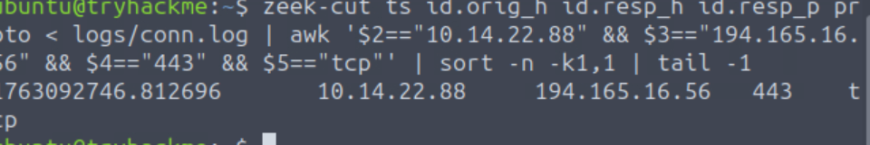

*Evidence: Last TCP/443 session and timestamp.*

## 4. DNS tunnelling record type

```bash
zeek-cut ts id.orig_h query qtype_name < logs/dns.log | grep '10.14.22.88' | grep 'exfil-channel.net' | head -20
zeek-cut id.orig_h query qtype_name < logs/dns.log | awk '$1=="10.14.22.88" && $2 ~ /exfil-channel\.net/ {print $3}' | sort | uniq -c
```

**Answer:** `TXT` — **18** matching queries. Long encoded-looking subdomains suggest DNS tunnelling but do not, alone, prove data exfiltration.

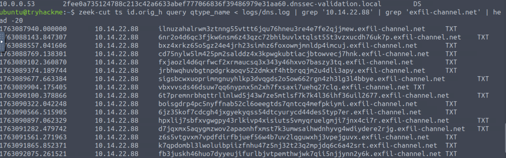

*Evidence: TXT queries from suspicious host.*
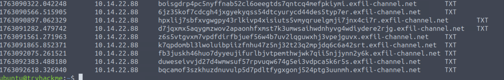

*Evidence: Additional TXT query records.*
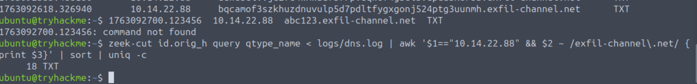

*Evidence: Count of 18 TXT queries.*

## 5. HTTP POST at 03:15 UTC

```bash
zeek-cut ts id.orig_h id.resp_h method host uri < logs/http.log | awk '$4=="POST"'
zeek-cut ts id.orig_h id.resp_h method host uri < logs/http.log | awk '$4=="POST" {cmd="date -u -d @"$1" +%H:%M:%S"; cmd | getline t; close(cmd); print t, $0}'
```

**Observed:** `1763090107.081000` = `03:15:07 UTC`, from `10.14.22.88` to `185.213.154.201`, POST `/upload/data`.

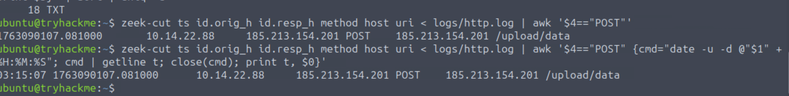

*Evidence: HTTP POST and UTC timestamp.*

### DNS query associated with the HTTP exfiltration

```bash
zeek-cut ts id.orig_h query qtype_name < logs/dns.log | awk '$1 < 1763090107.081000' | sort -n -k1,1 | tail -10
zeek-cut ts id.orig_h query answers < logs/dns.log | grep '185.213.154.201'
```

**Accepted answer:** `backup.corpfiles-sync.com`. Its A record resolved to `185.213.154.201` at timestamp `1763090096.000000` (03:14:56 UTC). A long `exfil-channel.net` TXT query occurred later at 03:15:00, but that was **not** the relevant domain for the HTTP destination. **Lesson:** nearest-in-time is not equivalent to associated; corroborate DNS `answers` against the actual destination IP.

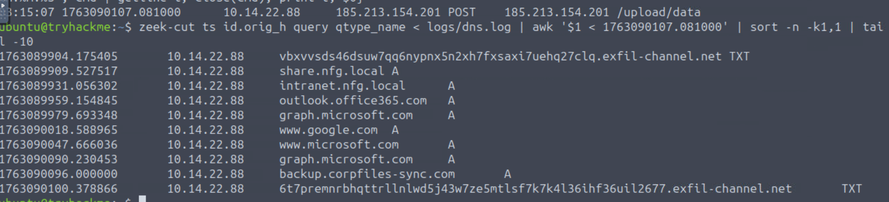

*Evidence: DNS queries before HTTP POST: both candidates visible.*

## 6. Domain associated with repeated HTTPS destination

```bash
zeek-cut ts query answers < logs/dns.log | grep '194.165.16.56'
zeek-cut query answers < logs/dns.log | awk '$2 ~ /194\.165\.16\.56/ {print $1}' | sort -u
```

**Answer:** `update.softpatch-cdn.com` → `194.165.16.56`. This association gives naming context for the repeated TCP/443 sessions, not independent proof of C2.

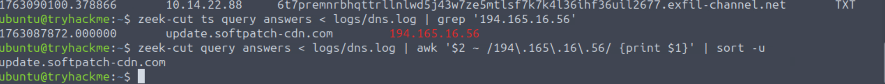

*Evidence: DNS resolution to repeated HTTPS destination.*

## 7. TLS sessions with missing SNI

```bash
zeek-cut id.resp_h server_name < logs/ssl.log | awk '$1=="194.165.16.56" && ($2=="-" || $2=="")' | wc -l
```

**Answer:** **82**. Zeek's unset marker is typically `-`. Missing SNI can be benign or suspicious depending on the client and traffic context.

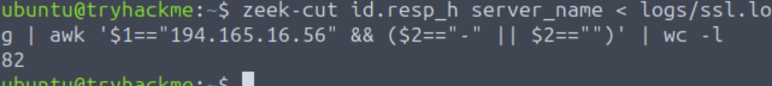

*Evidence: Count of TLS sessions with empty server_name.*

## 8. Uploaded file, MIME mismatch, and threat intelligence

### Filename of the ~5.3 MB POST

```bash
zeek-cut fuid filename seen_bytes total_bytes < logs/files.log | awk '$3>=5000000 && $3<=5600000'
```

**Answer:** `backup_archive.zip` (reported by the user as accepted; the later file-record screenshot confirms the name and 5,348,721 seen bytes).

### PDF extension versus actual file content

```bash
zeek-cut filename mime_type < logs/files.log | grep 'invoice_march.pdf'
zeek-cut fuid filename mime_type seen_bytes < logs/files.log | grep 'invoice_march.pdf'
```

**Answer:** `application/x-dosexec` for `invoice_march.pdf` (92,160 observed bytes). This is a file masquerading indicator: the extension does not match the detected executable content.

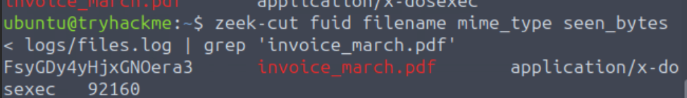

*Evidence: Invoice PDF filename with executable MIME type.*

### SHA256 correlation with local threat feed

```bash
zeek-cut filename sha256 < logs/files.log | grep 'backup_archive.zip'
head -5 threat-feed.csv
HASH=$(zeek-cut filename sha256 < logs/files.log | awk '$1=="backup_archive.zip" {print $2; exit}')
grep -iF "$HASH" threat-feed.csv
```

**Hash:** `459b0165d7f2e577d60cd8c1244daded93f4457ed4a89983e5e36c490402bec`

**Answer:** `CobaltStrikeStager`; local feed row: `2025-11-10`, `high` confidence. This is a **lab-feed classification**, not proof that the ZIP executed as a stager.

**Troubleshooting:** Searching for the literal placeholder `PASTE_SHA256_HERE` returned nothing; substitute the actual hash or use the `HASH` variable.

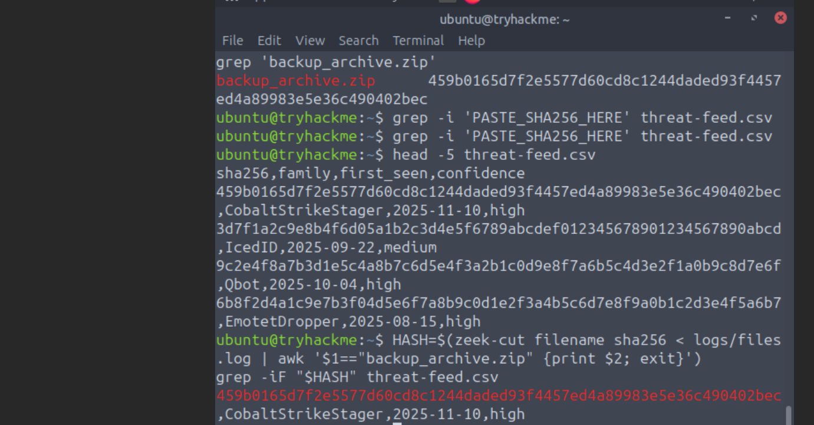

*Evidence: SHA256 extraction and matching threat-feed row.*

## 9. HTTP and connection byte accounting

```bash
zeek-cut uid id.orig_h id.resp_h method uri request_body_len < logs/http.log | awk '$2=="10.14.22.88" && $3=="185.213.154.201" && $4=="POST"'
zeek-cut uid id.orig_h id.resp_h orig_bytes < logs/conn.log | awk '$2=="10.14.22.88" && $3=="185.213.154.201"'
```

**Shared UID:** `CmQW1d3iuUHHDgqYe7`.

- `orig_bytes` = **5,348,913**
- `request_body_len` = **5,348,721**
- **Difference** = **192 bytes**

The difference represents originator application data beyond the HTTP body (likely headers and related request bytes). It does **not** measure network packet overhead.

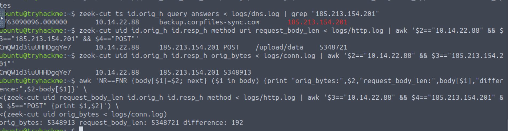

*Evidence: Cross-log UID match and 192-byte difference.*

### Responder file-body bytes

An attempted `files.log` UID search returned **no matches**:

```bash
zeek-cut conn_uids is_orig filename seen_bytes total_bytes < logs/files.log | grep 'CmQW1d3iuUHHDgqYe7'
```

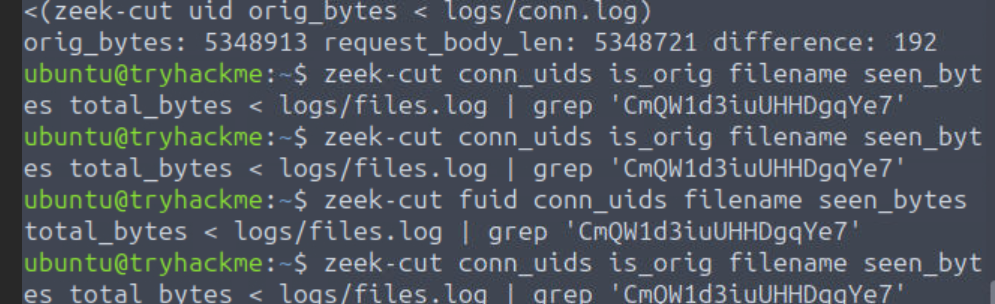

*Evidence: No matches from files.log conn_uids search.*

The corresponding `http.log` response was found with:

```bash
zeek-cut uid method uri response_body_len < logs/http.log | grep 'CmQW1d3iuUHHDgqYe7'
```

**Accepted answer:** **7 bytes**, confirmed from `http.log` `response_body_len`. **Caveat:** Although the lab accepted 7, the available screenshot does not demonstrate a responder-side `files.log` record of 7 bytes; avoid claiming that it does.

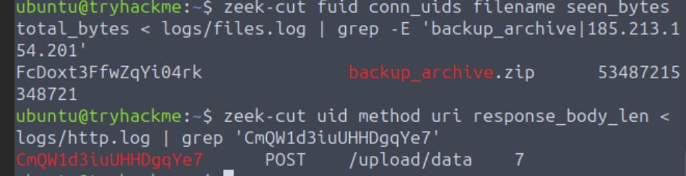

*Evidence: HTTP response_body_len equals 7.*

## 10. Detection scripting and baseline

The original script was located at `/home/ubuntu/scripts/dns_notice.zeek` — **not** in `/home/ubuntu/` itself. Early attempts from `/tmp/zeek-task7` and with the wrong script path failed, leaving no `notice.log`; `wc -l` printed 0 because input redirection failed, not because there were zero notices.

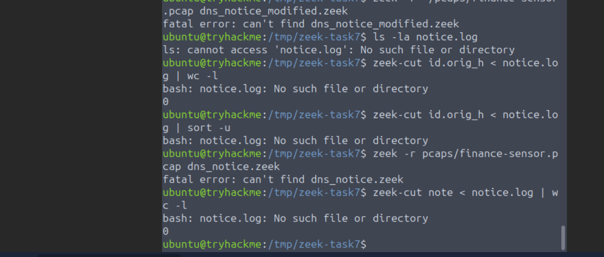

*Evidence: Original script path error and missing notice.log.*
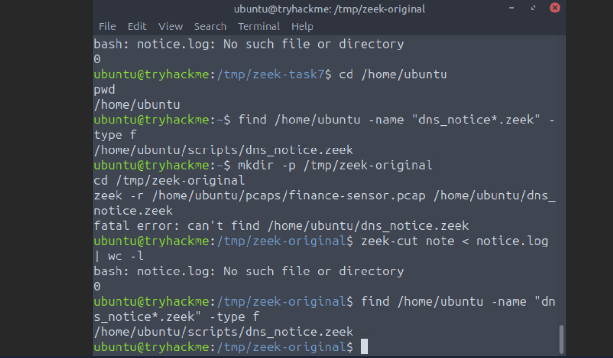

*Evidence: Finding the actual script location.*

Run the original in an isolated directory:

```bash
mkdir -p /tmp/zeek-original
cd /tmp/zeek-original
zeek -r /home/ubuntu/pcaps/finance-sensor.pcap /home/ubuntu/scripts/dns_notice.zeek
zeek-cut note < notice.log | wc -l
```

**Accepted baseline:** **23 notices**.

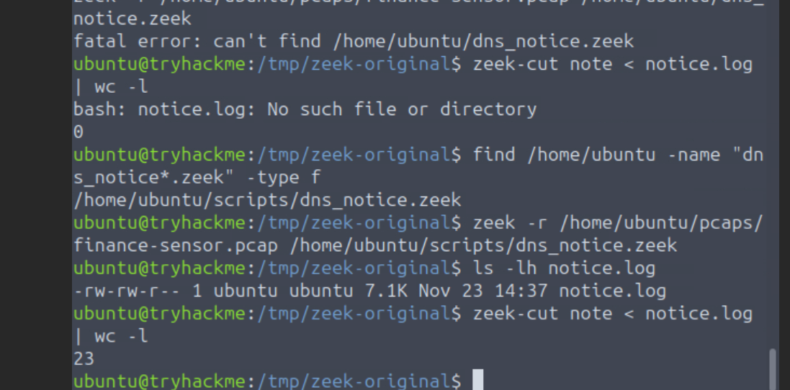

*Evidence: Successful baseline run with 23 notices.*

## 11. Tune false positives without masking suspicious traffic

The task identified `10.0.0.53` as a legitimate DNS server producing long DNSSEC validation queries. Baseline notice distribution:

```bash
zeek-cut id.orig_h < /tmp/zeek-original/notice.log | sort | uniq -c
```

```text
13 10.0.0.53
10 10.14.22.88
```

The original script's `dns_request` event tested `|query| > 60` and generated `DNS_Exfil_LongQuery` notices. Add an early return **inside the event handler, before the length check**:

```zeek
event dns_request(c: connection, msg: dns_msg, query: string, qtype: count, qclass: count)
    {
    if ( c$id$orig_h == 10.0.0.53 )
        return;

    if ( |query| > 60 )
        {
        # Keep the original NOTICE(...) code here unchanged.
        }
    }
```

The code above is a **placement illustration**, not a complete runnable replacement for the original script. To insert it into a copy without Nano:

```bash
cp /home/ubuntu/scripts/dns_notice.zeek /tmp/dns_notice_tuned.zeek
sed -i '/if ( |query| > 60 )/i\    if (c$id$orig_h == 10.0.0.53)\n        return;\n' /tmp/dns_notice_tuned.zeek
tail -18 /tmp/dns_notice_tuned.zeek
```

The provided screenshots document that the first edited copy **did not contain** the suppression condition; rerunning it still generated 23 notices. The browser intercepted `Ctrl+W` (close tab) instead of Nano's search; a Nano save prompt required pressing **Enter** before `Ctrl+X` could exit. Inspect the script and use the command-line edit if browser shortcuts interfere.

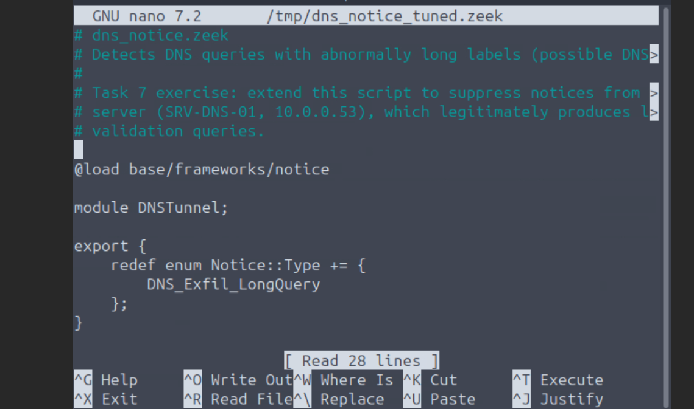

*Evidence: Original script opened in Nano.*
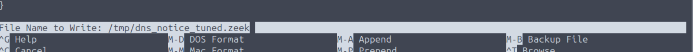

*Evidence: Nano save confirmation prompt.*
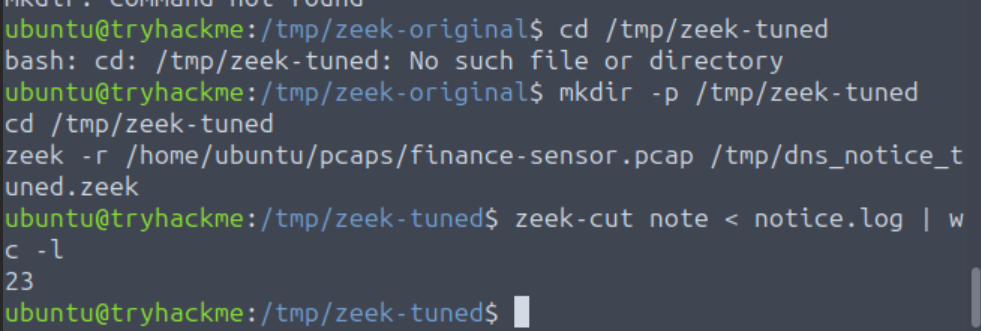

*Evidence: Untuned rerun still reports 23 notices.*
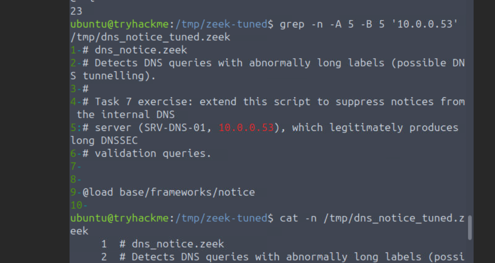

*Evidence: Grep found only the comment referencing 10.0.0.53.*
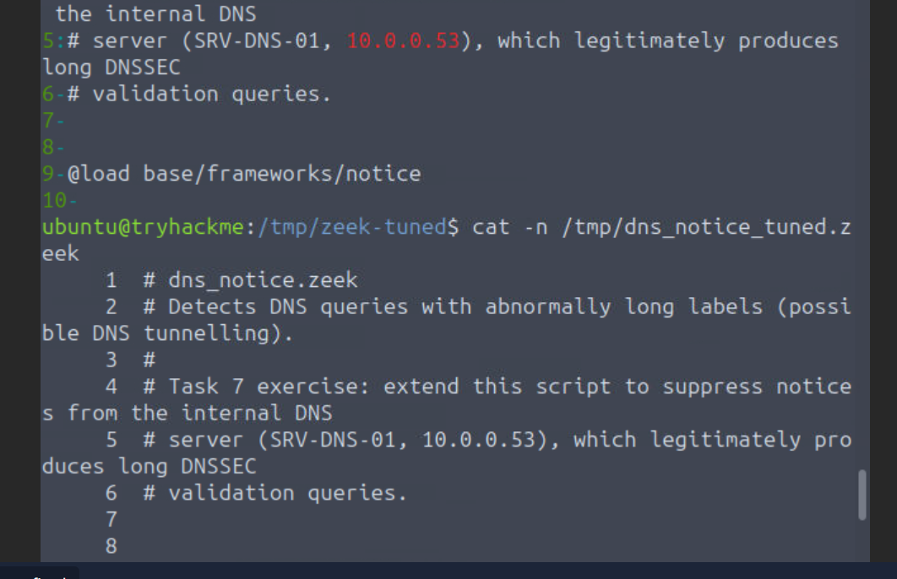

*Evidence: Script listing: first section.*
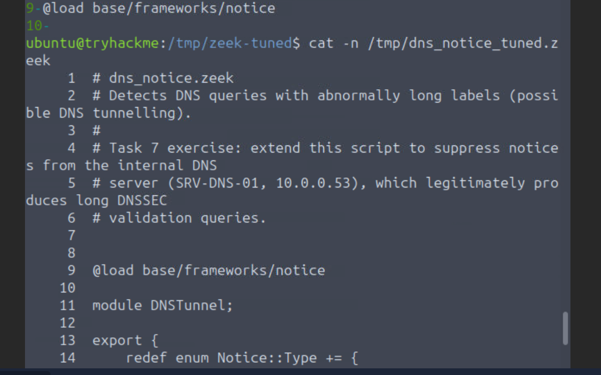

*Evidence: Script listing: event not yet visible.*
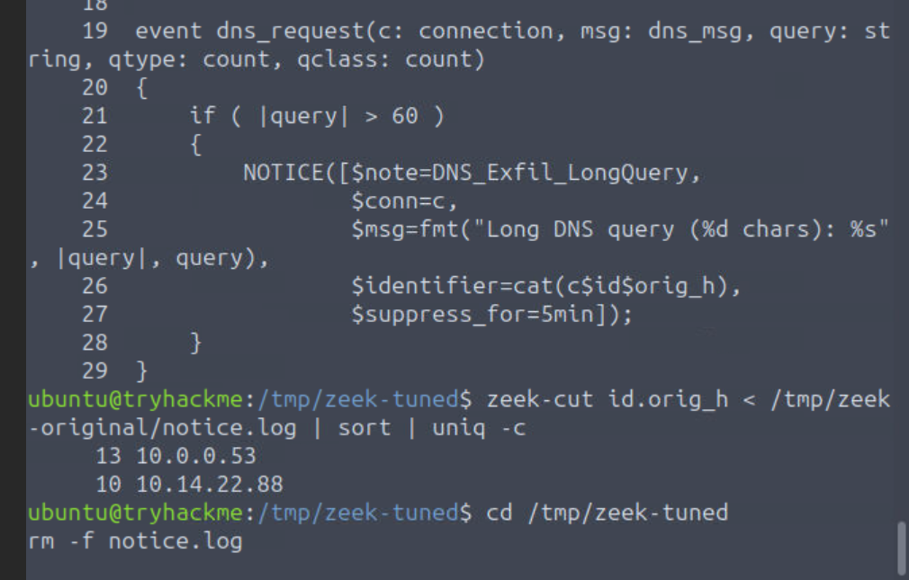

*Evidence: Event logic and baseline source breakdown.*
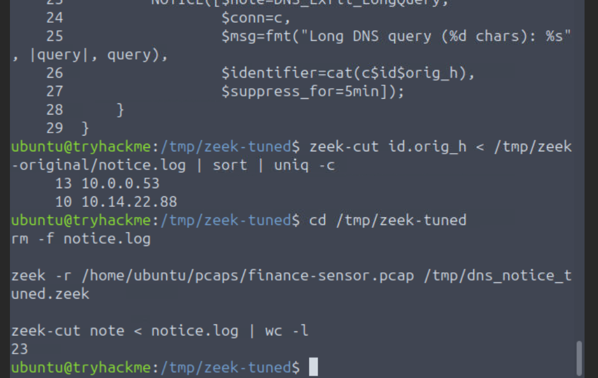

*Evidence: Another untuned rerun still returns 23.*

After editing, verify the script contains the early return and rerun cleanly:

```bash
mkdir -p /tmp/zeek-tuned
cd /tmp/zeek-tuned
rm -f notice.log
zeek -r /home/ubuntu/pcaps/finance-sensor.pcap /tmp/dns_notice_tuned.zeek
zeek-cut note < notice.log | wc -l
zeek-cut id.orig_h < notice.log | sort | uniq -c
```

**Accepted tuned count:** **10** notices, calculated as `23 − 13 = 10` and confirmed by the user's accepted lab answer. The original 10 notices from `10.14.22.88` are expected to remain. **The screenshot collection does not include a successful post-fix 10-notice terminal output**; do not mislabel a 23-notice screenshot as proof of the final run.

## 12. Timeline and conclusions

| UTC time / timestamp | Evidence | Interpretation |
|---|---|---|
| `1763087872.000000` | `update.softpatch-cdn.com` resolves to `194.165.16.56` | Domain context for repeated HTTPS traffic |
| `03:14:56` | `backup.corpfiles-sync.com` resolves to `185.213.154.201` | DNS resolution associated with HTTP upload destination |
| `03:15:00` | Long `exfil-channel.net` TXT query | Potential DNS tunnelling indicator, separate from the POST destination lookup |
| `03:15:07` | HTTP POST `/upload/data`, body 5,348,721 bytes | Suspected upload/exfiltration |
| `1763092746.812696` | Latest matching TCP/443 session to `194.165.16.56` | Repeated destination contact |

**Lessons:** Correlate logs using UID; corroborate DNS answers against destination IPs; distinguish benign DNSSEC activity from suspicious long TXT queries; check MIME rather than trusting extensions; use local hash feeds as supporting intelligence; and measure notice reduction while retaining the detections of interest.

## 13. Confirmed answers and evidence limitations

| Question | Answer | Status |
|---|---|---|
| First SMB S0 destination | Not preserved | Accepted by user; value unavailable |
| Last TCP/443 timestamp | `1763092746.812696` | Screenshot |
| Long DNS query record type | `TXT` | Screenshot |
| DNS domain associated with HTTP POST | `backup.corpfiles-sync.com` | Accepted and DNS mapping shown |
| Domain resolving to `194.165.16.56` | `update.softpatch-cdn.com` | Screenshot |
| TLS sessions with missing server_name | `82` | Screenshot |
| HTTP POST URI | `/upload/data` | Screenshot |
| POST file name | `backup_archive.zip` | Accepted; file record visible |
| Disguised PDF MIME type | `application/x-dosexec` | Screenshot |
| Threat-feed family | `CobaltStrikeStager` | Screenshot |
| Byte difference | `192` | Screenshot |
| HTTP response body | `7` | Screenshot and accepted; not demonstrated in files.log |
| HTTP destination domain | `backup.corpfiles-sync.com` | Screenshot and accepted |
| Original notices | `23` | Screenshot and accepted |
| Tuned notices | `10` | Accepted; final run not pictured |
