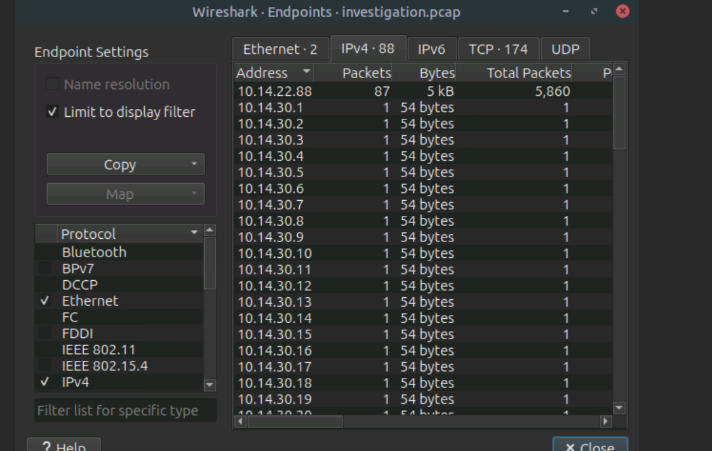
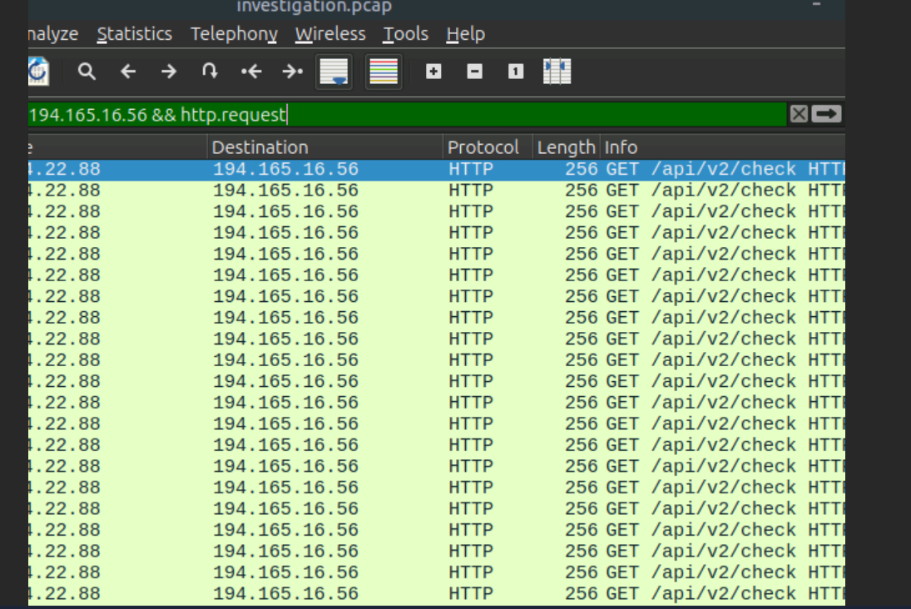
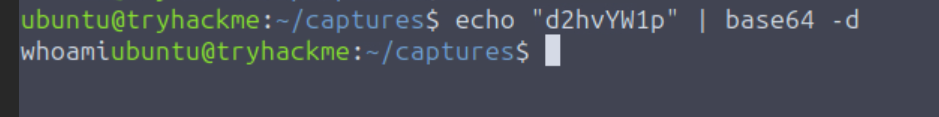
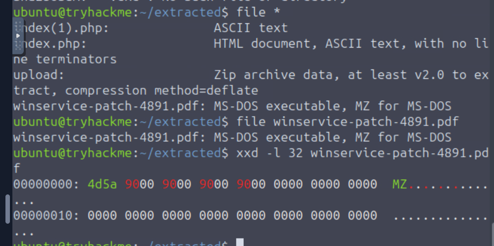
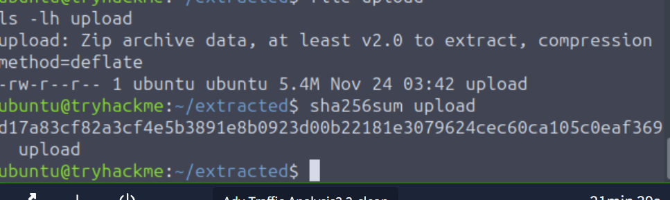
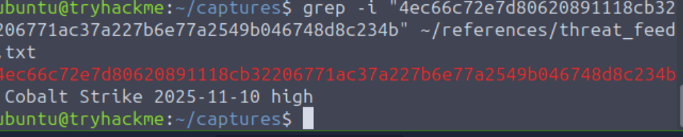
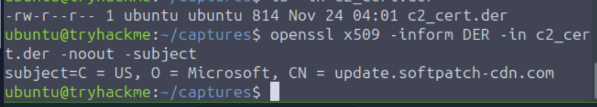
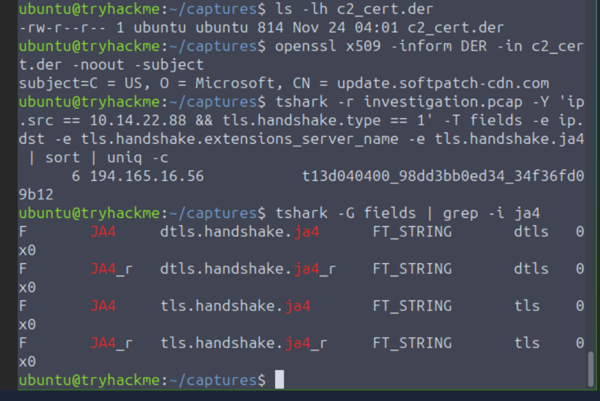
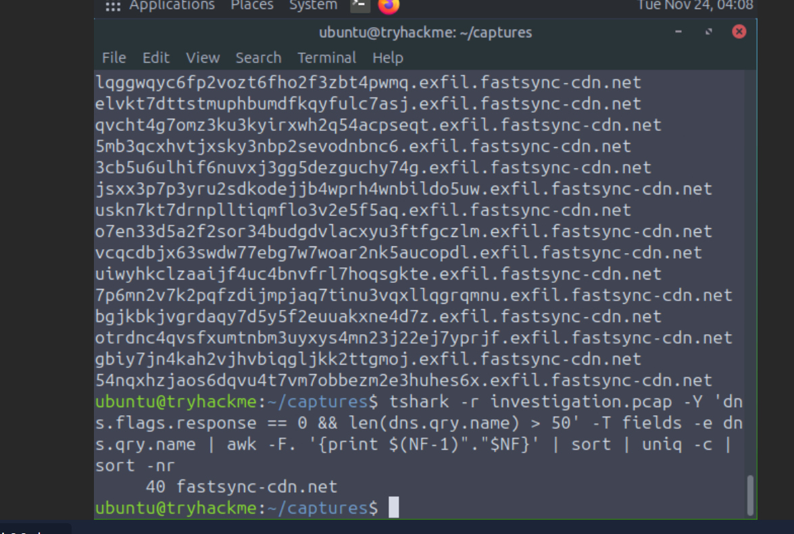
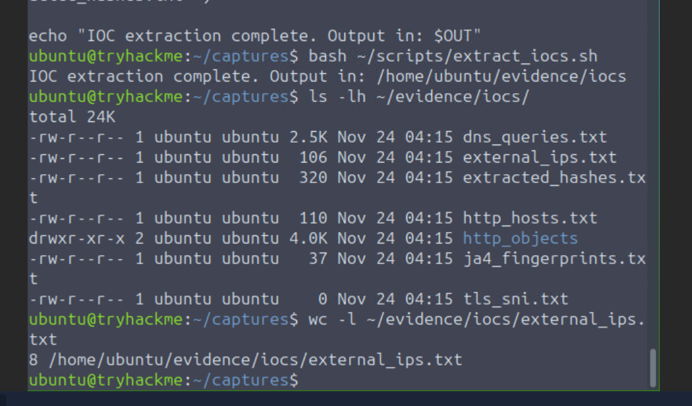

# Investigation report

## Executive summary
I investigated traffic involving 10.14.22.88 using investigation.pcap. The evidence supports reconnaissance, repeated C2-like traffic, remote command execution, archive staging and an HTTP transfer. The supplied threat feed assigns Cobalt Strike to the extracted executable with high confidence. DNS queries suggest another possible exfiltration channel.

## Methodology
I narrowed each question with display filters, checked endpoint counts, followed TCP streams, exported HTTP objects, verified file signatures and calculated hashes. I then correlated the executable hash against the local threat feed and extracted TLS and DNS indicators. Finally I ran the supplied IoC script. The original capture was not available for independent re-analysis when preparing this report; findings are based on the recorded lab outputs.

## Findings

### 1. Network scanning
87 unique destinations in 10.14.30.0/24.

The broad SYN filter returned 96 endpoints (95 destinations). Restricting to the sequential target subnet returned 88 endpoints, including the source.

### 2. HTTP beaconing
23 GET requests to 194.165.16.56, URI /api/v2/check.

Count requests, not unique IPs. Repeated URI and packet size support beaconing; timing should be checked separately.

### 3. Base64 command
d2hvYW1p decodes to whoami.

Decode only; do not execute captured commands. The final echo adds a newline.

### 4. FTP credentials
FTP control traffic exposed an administrator credential. Password withheld.

Plain FTP provides no confidentiality for authentication. Credential values and screenshot withheld.

### 5. Reverse shell and archive staging
Frame 643, stream 112; remote endpoint 194.165.16.78:4444; user corp\jsmith; Documents contents staged as C:\Temp\docs.zip.

Read the stream rather than executing commands. The captured Compress-Archive invocation specifies C:\Users\jsmith\Documents\* and C:\Temp\docs.zip as destination.

### 6. HTTP redirect
winservice-patch-4891.pdf; redirect from 203.0.113.50 to files.cdn-delivery.net.

Location header identifies the target; a redirect alone does not establish execution.

### 7. Executable extraction
4ec66c72e7d80620891118cb32206771ac37a227b6e77a2549b046748d8c234b

Use File > Export Objects > HTTP in Wireshark and save into ~/extracted. sha256sum *.exe failed because the executable had a PDF extension. MZ (4D 5A) and file output identify an MS-DOS executable signature; PE validity was not established.

### 8. Archive extraction
d17a83cf82a3cf4e5b3891e8b0923d00b22181e3079624cec60ca105c0eaf369

Exported object upload is ZIP data, displayed as 5.4M by ls. The reverse shell identifies docs.zip and HTTP POST /upload.

### 9. Threat intelligence correlation
Cobalt Strike; feed date 2025-11-10; high confidence.

find ~ -name "threat_feed.txt" located references, not captures. Feed attribution is not independent malware reverse engineering.

### 10. TLS certificate
Subject CN update.softpatch-cdn.com; C=US, O=Microsoft.

Placeholder certificate.der failed. The actual c2_cert.der was in ~/.local/share/Trash/files/ and was copied to captures. Organization claim is not proof of ownership.

### 11. JA4 fingerprint
t13d040400_98dd3bb0ed34_34f36fd09b12

Six Client Hellos share one fingerprint. tshark -G fields | grep -i ja4 checks field support. Fingerprints are not unique malware identifiers.

### 12. DNS tunnel hunting
exfil.fastsync-cdn.net; 40 long queries.

The initial awk expression retained only two labels and returned fastsync-cdn.net, which was rejected. Preserve the exfil label. Long names suggest tunnelling, not proof of transferred content.

### 13. Automated IoC extraction
8 unique external destination entries.

Inspect the script first with cat. Defaults are ~/captures/investigation.pcap and ~/evidence/iocs. It excludes RFC1918 and loopback, not all reserved ranges. TLS SNI output was empty.

## ATT&CK mapping
| Technique | Evidence |
|---|---|
| T1046 Network Service Discovery | Horizontal SYN scan |
| T1071.001 Web Protocols | Repeated HTTP beacons |
| T1033 System Owner/User Discovery | whoami |
| T1016 System Network Configuration Discovery | ipconfig in stream |
| T1059.001 PowerShell | Archive command in stream |
| T1560.001 Archive via Utility | Compress-Archive |
| T1074.001 Local Data Staging | docs.zip in Temp |
| T1036.008 Masquerade File Type | MZ file named .pdf |
| T1048.003 Exfiltration Over Unencrypted Non-C2 Protocol | HTTP POST archive, if separate from C2 |
| T1071.004 DNS | Suspected DNS tunnelling; conditional mapping |

## Limitations and conclusion
The activity categories are not a verified chronological timeline. The redirect and file signature do not prove execution. A hash match is feed attribution, not independent malware analysis. HTTP archive extraction supports a transfer but server-side retention is unverified. The DNS payload was not decoded. Eight external entries are candidates, not eight confirmed malicious hosts.
